 

---

**RadiaSight** is a real-time 3D radiation mapping ecosystem. It synchronizes spatial sensor feeds (LiDAR, SLAM, pose odometry) and nuclear detector readings (counts, dosage, spectrum) over a high-performance publish-subscribe network to reconstruct colorized radiation field point clouds.

---

## Architecture Flowchart

```mermaid
flowchart LR
  subgraph AIR["AIRCRAFT — PX4 + Jetson Orin Nano"]
    direction TB
    FC["PX4 flight controller<br/>RUN: PX4 firmware"]
    LIDAR["Livox MID-360"]
    RAD["RadiaCode"]
    CAM["Camera / external encoder"]

    LIV["livox_ros_driver2<br/>RUN • ROS 2 driver"]
    RN["radiacode_node<br/>ADAPT • ROS 2 driver"]
    GLIM["GLIM / glim_ros<br/>RUN + configure • ROS 2 SLAM"]
    REC["mission_recorder<br/>ADAPT • ROS 2 node"]
    MM["mission_manager<br/>WRITE • ROS 2 node + MAVLink endpoint"]
    CS["cloud_streamer<br/>WRITE • ROS 2 node → UDP"]
    VID["video_service<br/>WRITE / ADAPT • non-ROS"]
    MR["mavlink-routerd<br/>RUN + configure"]
    AL_A["LinkManager (air)<br/>ADAPT OpenIPC • non-ROS"]
    W_A["wfb-ng<br/>RUN + configure • raw Wi-Fi"]
    SSHD["sshd<br/>RUN + secure • optional development"]
    NVME[("NVMe: full MCAP + source video")]

    LIDAR --> LIV
    RAD --> RN
    LIV --> GLIM
    LIV --> REC
    RN --> REC
    GLIM --> REC
    GLIM --> CS
    LIV --> CS
    MM --> REC
    MM --> LIV
    MM --> RN
    REC --> NVME
    CAM --> VID
    VID --> NVME
    FC <-->|"MAVLink serial/Ethernet"| MR
    MM <-->|"local MAVLink"| MR
    MR <-->|"local MAVLink UDP; includes link feedback"| W_A
    MR -->|"MAVLink link feedback to air controller"| AL_A
    VID -->|"local RTP/UDP"| W_A
    CS -->|"local cloud UDP"| W_A
    AL_A -.->|"RF: MCS / FEC / power"| W_A
    AL_A -.->|"video preview budget"| VID
    AL_A -.->|"cloud preview budget"| CS
    SSHD -.->|"TCP 22 over optional IP tunnel"| W_A
  end

  subgraph GROUND["GROUND — Linux GCS"]
    direction TB
    W_G["wfb-ng<br/>RUN + configure • raw Wi-Fi"]
    GCS["GCS_LinuxApp<br/>ADAPT • MAVLink + video + cloud + SSH console<br/>Qt 6 / Vulkan"]
    AL_G["link_feedback (ground)<br/>ADAPT OpenIPC • non-ROS"]
    W_G <-->|"local MAVLink UDP"| GCS
    W_G -->|"local RTP/UDP"| GCS
    W_G -->|"local cloud UDP"| GCS
    W_G -.->|"receive stats"| AL_G
    AL_G -.->|"link metrics to GCS MAVLink sender"| GCS
    W_G <-.->|"optional SSH tunnel / TCP 22"| GCS
  end

  W_A <-->|"A: MAVLink + adaptive feedback<br/>bidirectional / shared BL-M8812EU2 RF"| W_G
  W_A -->|"B: RTP video downlink<br/>same shared RF"| W_G
  W_A -->|"C: point-cloud UDP downlink<br/>same shared RF"| W_G
  W_A <-.->|"D: SSH maintenance tunnel (optional)<br/>same shared RF; disabled in flight by default"| W_G

  classDef write fill:#fff0d8,stroke:#b56b00,color:#332200
  classDef adapt fill:#e8f2ff,stroke:#2d64a0,color:#12243a
  classDef run fill:#e8f7ed,stroke:#318454,color:#14351d
  class MM,CS,VID write
  class RN,REC,AL_A,AL_G,GCS adapt
  class FC,LIV,GLIM,MR,W_A,W_G,SSHD,SSH run
```

